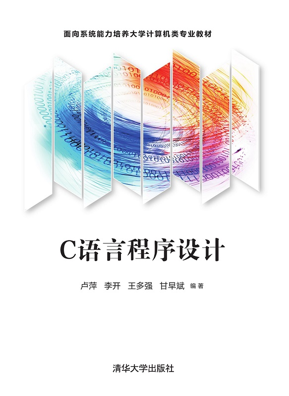

# 软件技术基础

<!-- _class: lead -->

## C语言

**施展**
武汉光电国家研究中心 & 计算机学院
华中科技大学
2025-11-11 (第11周周二) 至 2025-12-19 (第16周周五) @ 东九楼A201

---

## 授课教师

- **施展** 武汉光电国家研究中心，存储部，C523
- 联系方式
  - EMail <zshi@hust.edu.cn>
  - 电话 027-87792450
  - 主页
    - <https://shizhan.github.io/>
    - <http://faculty.hust.edu.cn/shizhan/zh_CN/index.htm>

---

## 基本信息

<!-- paginate: true -->

<style scoped>
  li {
    font-size: 27px;
  }
</style>



- 课程资料: <https://marp-public.pages.dev/c-language-pre>  
- 课程平台: [头歌平台教学课堂](https://www.educoder.net/classrooms)-《C语言程序设计2025秋》未来2502班（**邀请码：7BVX2R**）
- 教材与参考书
  - [**C语言程序设计**](http://www.tup.tsinghua.edu.cn/booksCenter/book_08344701.html), 作者：卢萍、李开、王多强、甘早斌，清华大学出版社, 2021
  - [C语言程序设计典型题解与实验指导](http://www.tup.tsinghua.edu.cn/booksCenter/book_08344801.html)，作者：卢萍、李开、王多强、甘早斌，清华大学出版社，2019

---

## 背景知识

```python
if not 学习过"缺失的一课"，至少第6讲:
    if not 独立维护过Github或Gitee等开放Git仓库:
        随我进行课堂练习
```

[计算机教育中缺失的一课](https://missing-semester-cn.github.io/)，[官网](https://missing.csail.mit.edu/)，[B站](https://www.bilibili.com/video/BV1x7411H7wa/)

与本次课程相关的基础训练

- 1/13: 课程概览与 shell
- 1/14: Shell 工具和脚本
- 1/22: 版本控制([Git](https://git-scm.com/download))

---

## 学习内容（1～5章）

<style scoped>
  table {
    font-size: 27px;
  }
</style>

| 授课章节 | 主要内容概要 | 周二(7-8) | 周五(3-4) |
| :---    | :---        | :--- | :--- |
| [0 关于这门课](c-language-pre) | 课堂基本信息 | 09-30 | |
| [1 概论](c-language-background) | 基础知识 | | 10-03 |
| [2 基本元素](c-language-basics) | 字符、标识、数据类型、常量与变量 | 10-07 | |
|| 运算符和表达式、位运算、类型转换 | | 10-10 |
| [3 格式化输入与输出](c-language-stdio) | 字符输入输出、格式化输入输出 | 10-14 | 10-17 |
| [4 流程控制](c-language-branch) | 条件、循环、转移、实例 | 10-21 | 10-24 |
| [5 函数](c-language-function) | 模块化、自定义函数、参数类型 | 10-28 | 10-31 |
|| 递归、多文件程序 | 11-04 | 11-07 |

---

## 学习内容（6～10章）

<style scoped>
  table {
    font-size: 27px;
  }
</style>

| 授课章节 | 主要内容概要 | 周二(7-8) | 周五(3-4) |
| :---    | :---        | :--- | :--- |
| [6 编译预处理](c-language-compiler) | 宏定义、文件包含、条件编译 | 11-11 | |
| [7 数组](c-language-array) | 一维/二维数组、字符数组 | | 11-14 |
|| 排序与查找算法 | 11-18 ||
| [8 指针](c-language-pointer) | 指针概念、指针与数组/字符串 | | 11-21 |
|| 指针数组、函数指针| 11-25 | 11-28 |
| [9 结构与联合](c-language-struct) | 结构体、联合体 | 12-02 | 12-05 |
|| 结构数组、单链表操作| 12-09 | 12-12|
| [10 文件](c-language-file) | 文件操作、顺序/随机读写、文件状态检测 | 12-16 | 12-19 |

---

## AI 时代，为什么这门课还要手写 C？

本课程定位为**第一门编程课**：目标不是"熟悉一门语言"，而是建立**编程判断力**。

- **基础不减**：手写 C（尤其指针、内存、调试）是训练"不可外包的底层判断力"的场地。AI 生成的代码一旦出错（段错误、野指针），你能不能打开黑盒、解释机理、定位问题？
- **能力保护区**：下列练习必须**关闭 AI、独立完成**——指针 / 数组边界、内存分配与释放、调试排错、手写排序与链表。
- **AI 是"书童式助教"，不是"智能秘书"**：可答疑、给提示、检查错误；但任务所有权、判断权、最终责任仍归你。
- **验证本能**：写完代码先问"它真的对吗？"——构造反例、设计测试、用 `assert` 设栅栏（第 6 章），这是 AI 时代不可退让的底线。

> 观点来源：CCCF 2026 年第 9 期《当 AI 开始批量生产代码，高校究竟该培养什么？》（FCES 2026 专题论坛综述）
