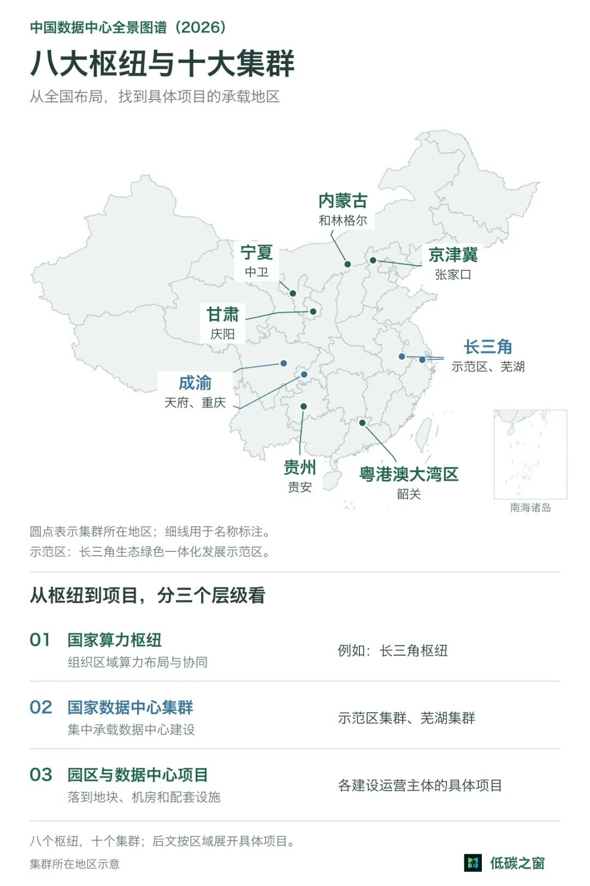
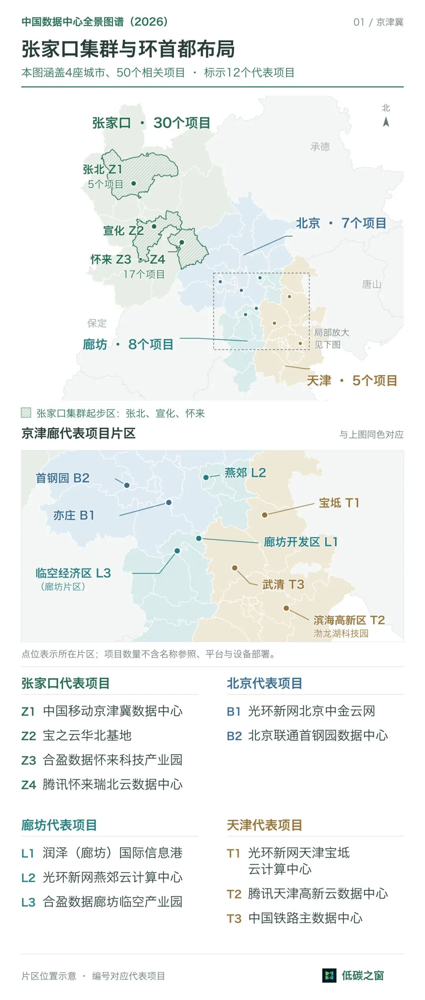
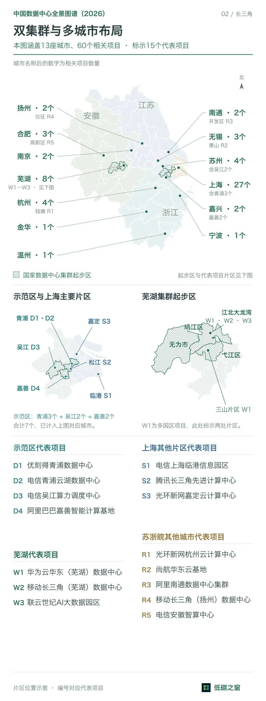
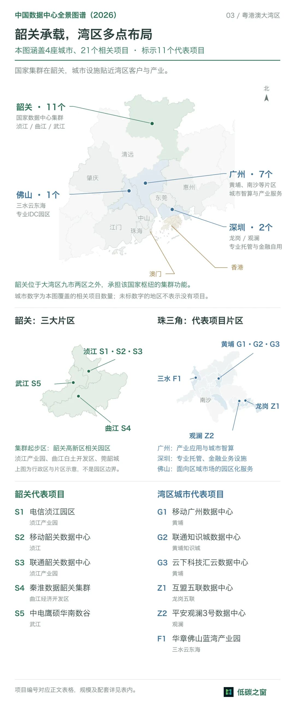
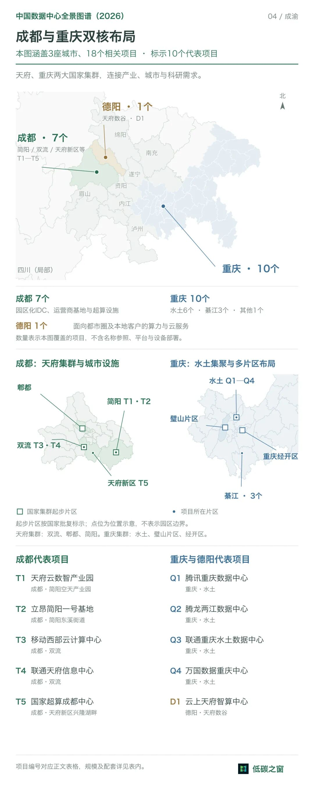
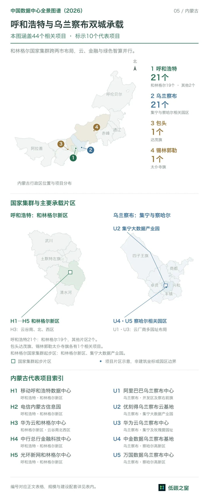
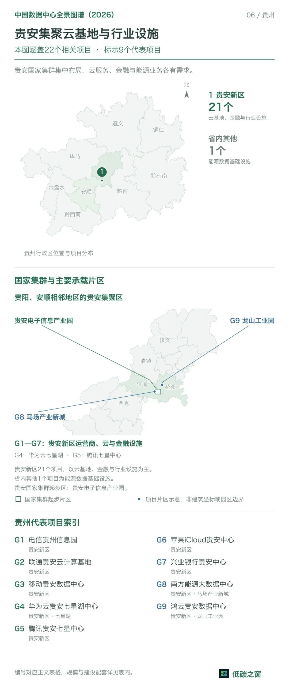
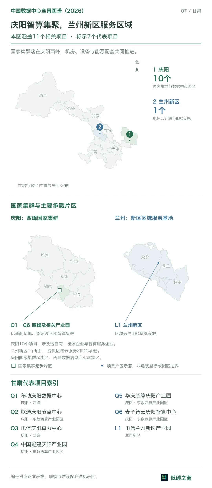
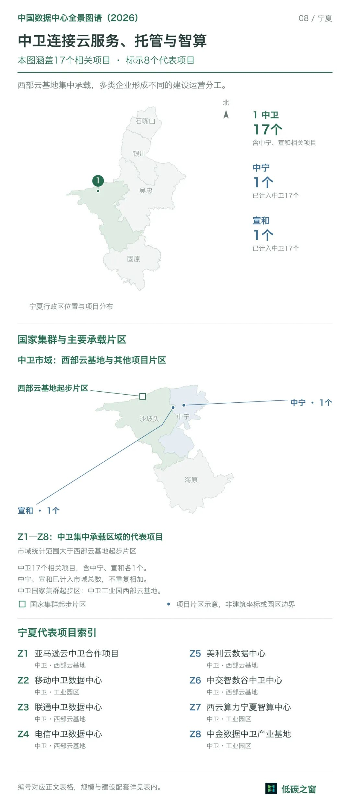

<!-- _class: lead -->

# 中国数据中心：国家战略布局

**《数据中心全景图谱（2026）》课堂扩展**

东数西算 · 八大枢纽 · 十大集群

施展 · 数据中心技术

---

## 为什么讲这一节

数据中心不只是"机房"——它建在哪、由谁建、配多少电，背后是一张**国家算力网络**的顶层设计。

本节作为课程背景扩展，回答三个问题：

- **国家怎么布局**：东数西算的 8 枢纽 / 10 集群
- **企业怎么落子**：阿里、腾讯、华为、运营商、IDC、金融
- **技术怎么被牵引**：选址、功率、散热、算电协同随之改变

**素材**：公众号「低碳之窗」《中国数据中心全景图谱（2026）》，243 个项目 / 82 个代表项目。

---

## 东数西算：国家算力网络的骨架

2022 年工程全面启动。国家在八地布局**算力枢纽**，并在其中规划**十个国家数据中心集群**。

- 为大型、超大型数据中心确定**主要承载地区**
- 为**跨区域算力协同**提供组织框架
- 本质：把算力需求（东 / 南）与资源条件（西 / 北）在空间上重新匹配

---

## 三层层级：从国家战略到一块机房

阅读项目信息时常混用"枢纽 / 集群 / 园区"，它们其实是**不同层级**：

| 层级 | 含义 | 例子 |
|---|---|---|
| ① 国家算力枢纽 | 区域算力承载节点 | 长三角枢纽（沪苏浙皖） |
| ② 数据中心集群 | 枢纽内集中承载区，可跨行政区 | 示范区集群（青浦+吴江+嘉善） |
| ③ 园区与项目 | 落到地块、机房及配套设施 | 各主体的具体项目 |

**易混点**：和林格尔集群起步区同时含**呼和浩特**和林格尔新区与**乌兰察布**集宁大数据产业园。

---

## 八大枢纽 ↔ 十大集群

长三角、成渝各有两个集群，其余六个各一个 → 8 枢纽对应 10 集群。

| 枢纽 | 国家集群 | 项目数 | 代表 |
|---|---|---|---|
| 京津冀 | 张家口 | 50 | 12 |
| 长三角 | 示范区、芜湖 | 60 | 15 |
| 粤港澳 | 韶关 | 21 | 11 |
| 成渝 | 天府、重庆 | 18 | 10 |
| 内蒙古 | 和林格尔 | 44 | 10 |
| 贵州 | 贵安 | 22 | 9 |
| 甘肃 | 庆阳 | 11 | 7 |
| 宁夏 | 中卫 | 17 | 8 |

---

## 选址逻辑：需求与资源匹配

不同业务对选址的约束完全不同——这是理解布局的钥匙：

- **时延敏感**（视频通话、实时交互）：重客户距离与网络连接
- **空间型**（存储备份、离线分析）：选址空间大，可放西部
- **AI 训练**：重集群规模与持续供电
- **在线推理**：兼顾响应时延与算力就近

接入容量、供电可靠性、网络、冷却共同决定集群能长到多大。

---

## 京津冀：张家口 + 环首都

4 城 50 项目（张 30 / 廊 8 / 京 7 / 津 5）：

- **张家口**：腾讯瑞北（30 万台）、宝之云（宣钢改造）、合盈（大模型训练）
- **廊坊 / 北京**：润泽信息港、光环新网；中金云网（金融）、首钢园（冬奥改造）
- **天津**：腾讯高新云、中国铁路主数据中心

**特点**：围绕首都需求分层布局。

---

## 长三角：双集群 + 多城市

13 城 60 项目，密度全国最高：

- **示范区**（跨沪苏浙）：优刻得、吴江电信（1 万+ 高功率机架）、嘉善阿里（20 万台）
- **芜湖**：华为云华东（300 万台）、移动（40 kW 智算 + 7 kW 通算）
- **上海**：临港电信（万卡液冷）、松江腾讯（2.4 万柜）

**特点**：双集群 + 产业密集，多中心。

---

## 粤港澳：韶关承载，湾区就近

4 城 21 项目（韶 11 / 穗 7 / 深 2 / 佛 1）：

- **韶关**：电信 5.04 万架、秦淮数据（IT >200 MW，**PUE ≤ 1.197**）
- **广州 / 深圳**：黄埔液冷、联通知识城、互盟 3000 柜、平安观澜 3 号
- **佛山**：蓝湾 1.2 万柜

**特点**：韶关集中承载 + 湾区就近服务，**网络连接是关键**。

---

## 成渝：双核布局

3 城 18 项目（蓉 7 / 渝 10 / 德 1）：

- **成都**：天府云 5 千柜、双流 20 kW 高功率、国家超算成都中心
- **重庆**：水土腾讯（20 万台）、万国、联通
- **德阳**：云上天府智算中心（6,120 柜，**PUE ≤ 1.20**）

**特点**：本地产业与科研需求强，双核多片区。

---

## 内蒙古：呼市 + 乌兰察布

44 项目（呼 21 / 乌 21 / 包 1 / 锡 1）：

- **和林格尔**：中行 3 万台、移动 120 MW 冷板液冷、光环新网 90–120 MW
- **乌兰察布**：优刻得 6000×8.8 kW、中金数据 **338 MW**（风 200 + 光 100 + 储 45 MW/4h）

**特点**：从通用机房 → 高功率智算，向**能源配套**延伸。
（与「乌兰察布算力集群实景照片集」互补。）

---

## 贵州：贵安集聚

22 项目（贵安 21 / 其他 1）：

- **运营商**：电信 5 万架、联通 2.2 万物理架、移动 7000×5 kW
- **云厂商**：华为七星湖（**100 万台**）、腾讯七星（山体洞库）、苹果 iCloud
- **行业**：兴业银行（自用）、南方能源（5000×10 kW）、鸿云托管

**特点**：大型基地集中，客户分工清晰；水电 + 洞穴散热。

---

## 甘肃：庆阳智算 + 兰州新区

11 项目（庆 10 / 兰 1）：

- **庆阳运营商**：联通 8000 架 / 144 MW、电信至京沪穗西安各 **200G 直连**
- **能源智算**：能建源网荷储（12–140 kW）、华庆超算（2.1 万×25 kW）
- **兰州新区**：电信大数据产业园（3413 架）

**特点**：智算集群与能源配套**同推进**，网络连异地客户。

---

## 宁夏：云服务・托管・智算

中卫 17 项目：

- **云服务与运营商**：亚马逊云（西云数据运营）、移动 221.44 MW、联通 / 电信扩建
- **专业 IDC 与智算**：美利云、中交智数谷（15,680 架）、西云算力（GPU）、中金（12,500×16 kW）

**特点**：云服务运营、机房托管、智算资源**三角色并行**。

---

## 建设主体：四种角色

认清楚"谁在干什么"，是看懂项目表的钥匙：

| 角色 | 代表 | 干什么 |
|---|---|---|
| 运营商 | 电信 / 移动 / 联通 | 连机房、网络与云 |
| 云厂商 | 阿里 / 腾讯 / 华为 | 围绕自身业务组织基础设施 |
| 专业 IDC / 算力服务 | 万国 / 光环 / 润泽 | 交付环境，部分部署 GPU |
| 行业机构 | 银行 / 铁路 / 超算 / 能源 | 自用或行业专用设施 |

**注**：同一企业可能身兼数角；建设方、运营方、设备部署方、服务购买方常分开。

---

## 三大趋势：布局在怎样变化

1. **集中建设与城市服务长期并存**
   大型基地集中扩容，城市设施贴近客户；分工随时延、网络变化。

2. **智算扩张，首先改变机房的功率与散热**
   芜湖 40 kW 智算 vs 7 kW 通算同园区；成渝、内蒙高功率 + 液冷。同样千柜，供电制冷差很大——要看 **IT 功率 + 单柜功率**。

3. **能源条件进入项目整体方案**
   乌兰察布风光储、庆阳源网荷储、变电站液冷。资源优势转化为算力，落脚于**算电协同**。

---

## 关键数字速览

| 维度 | 数字 |
|---|---|
| 总建设项目 | 243 个 + 14 项算力服务与设备 |
| 代表项目 | 82 个 |
| 国家布局 | 8 枢纽 / 10 集群 |
| 功率对比（芜湖移动） | 40 kW 智算 1,278 架 + 7 kW 通算 6,537 架 |
| 单体最大负荷 | 乌兰察布中金 338 MW（风 200 + 光 100 + 储 45 MW/4h） |
| 最低 PUE | 韶关秦淮 ≤ 1.197；德阳 ≤ 1.20 |
| 服务器规模 | 贵安华为 100 万；芜湖华为 300 万；张北腾讯 30 万 |

---

## 小结：从布局看技术

- 国家战略（东数西算）决定了**数据中心在哪**
- 选址（时延 / 资源）决定了**网络与供电设计**
- 智算浪潮把**单柜功率与液冷**推到前台
- 能源（风光储 / 源网荷储）成为**项目整体方案**的一部分

**配套素材**：`china-datacenter-panorama-2026.md`（图集）、`china-datacenter-panorama-2026-body.md`（正文）；与乌兰察布、华为超节点实景集互补。
