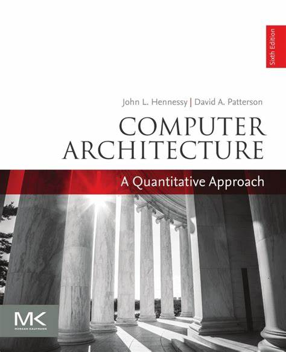
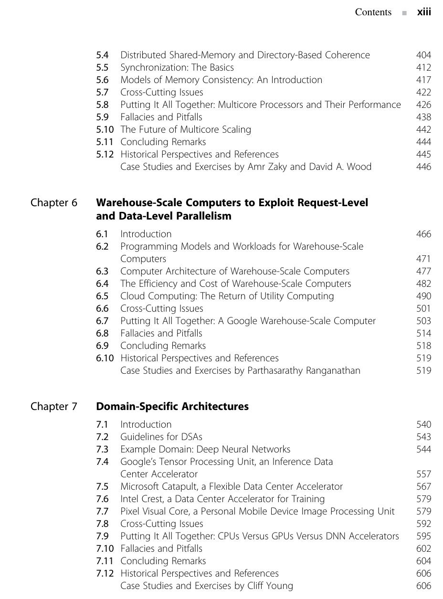
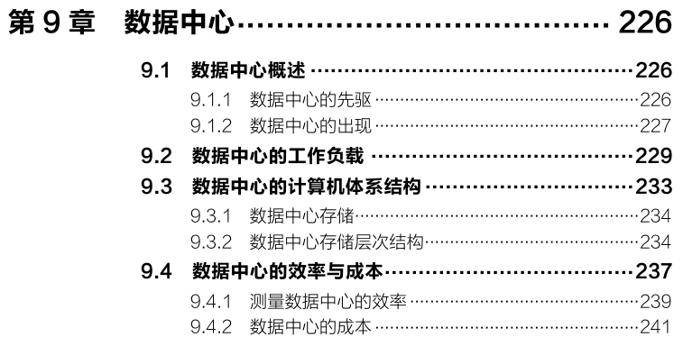
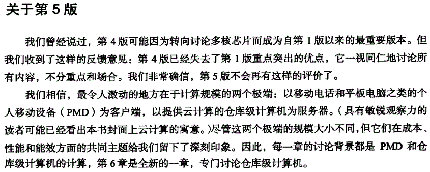
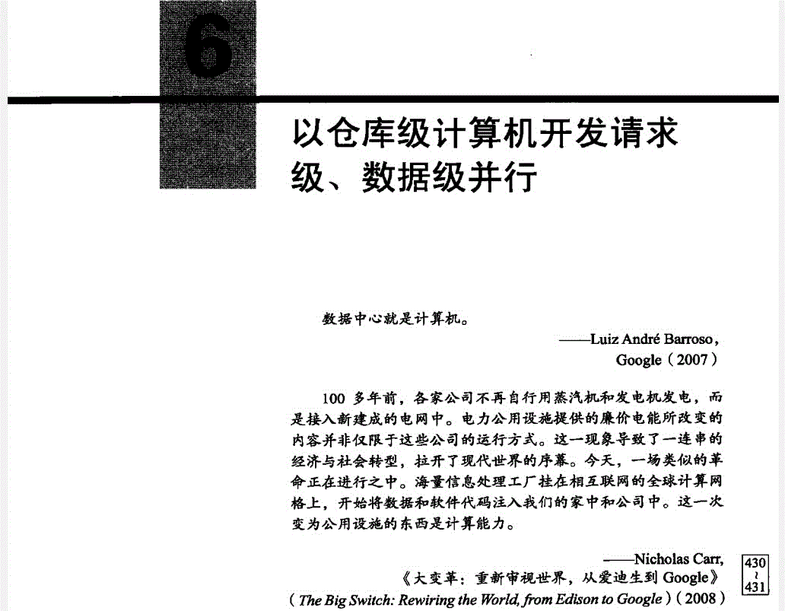
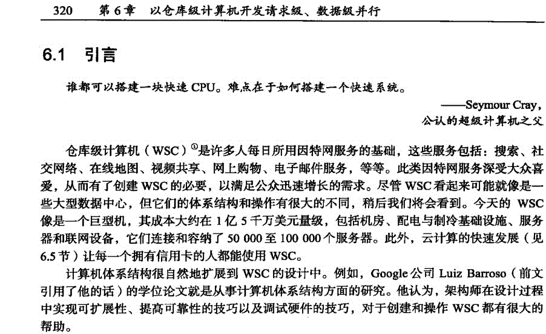
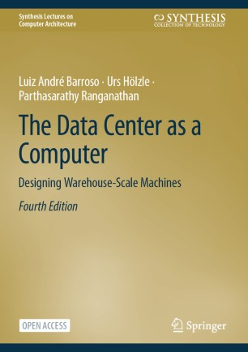
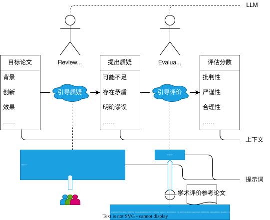

<!-- _class: lead -->

# 数据中心技术

(2026-2027 上学期)

**施展，童薇，胡燏翀，谭支鹏**
武汉光电国家研究中心，计算机学院
2学分 (32学时)

---

## 授课教师

- **施展** 武汉光电国家研究中心，C523，<zshi@hust.edu.cn>
- **童薇** 武汉光电国家研究中心，C522，<tongwei@hust.edu.cn>
- **胡燏翀** 计算机科学与技术学院，B518，<yuchonghu@hust.edu.cn>
- **谭支鹏** 武汉光电国家研究中心，C525，<tanzhipeng@hust.edu.cn>

---

## 基本信息

<!-- paginate: true -->

- 课程资料 <https://marp-public.pages.dev/data-center-pre>  
- 课程平台 <https://smartcourse.hust.edu.cn/mooc-ans/course/17310000017334.html>
- 参考书
  - [John Hennessy](https://hennessy.stanford.edu/), [David Patterson](https://www2.eecs.berkeley.edu/Faculty/Homepages/patterson.html), [**Computer Architecture: A Quantitative Approach**, 6th Edition.](https://www.elsevier.com/books/computer-architecture/hennessy/978-0-12-811905-1), 2017
  - [Luiz André Barroso](https://www.barroso.org/), Urs Hölzle, and Parthasarathy Ranganathan, [**The Data Center as a Computer: Designing Warehouse-Scale Machines**, Fourth Edition.](https://link.springer.com/book/10.1007/978-3-031-99489-0), 2026
  - [**数据中心一体化最佳实践：设计仓储级计算机**（原书第3版）](https://book.douban.com/subject/34950732/), [美] [路易斯·安德烈·巴罗索](https://www.barroso.org/) 著，徐凌杰 译, 2020
  - [计算机系统结构教程（第3版）](http://www.tup.tsinghua.edu.cn/booksCenter/book_09019101.html), 清华大学出版社, 2021
  - [计算机系统结构（微课版）](https://www.ptpress.com.cn/shopping/buy?bookId=43961df3-4a07-4e0e-8b0f-bdf3b21d695f), 人民邮电出版社, 2024

---

## 系统结构课堂延伸

- [**计算机体系结构：量化研究方法**（第6版）](https://item.jd.com/13427803.html), 人民邮电出版社, 2022

---

## 系统结构课堂延伸…

- [计算机系统结构（微课版）](https://www.ptpress.com.cn/shopping/buy?bookId=43961df3-4a07-4e0e-8b0f-bdf3b21d695f), 人民邮电出版社, 2024

---

---

---

---

## 新版参考书：从 **8 章**到 **12 章**

**第四版 · 2026**\
12 章 / 347 页

**第三版**\
8 章 / 189 页

开放获取\
新增案例 · 重绘插图\
优化在线阅读

#### 认识系统

1. 引言
2. WSC 体系结构概览
3. WSC 工作负载概览

#### 构建系统

4. WSC 软件：分布式系统基础设施 **【新增】**
5. WSC 硬件：数据中心基础设施
6. WSC 硬件：计算构建模块

#### 构建系统（续）

7. 软件定义基础设施 **【新增】**

#### 评价与保障

8. 性能与成本
9. 能源与可持续性
10. 可信计算：可靠性、可用性、安全与隐私

#### 回顾与导读

11. WSC 二十五年历程 **【新增】**
12. 二十五篇代表论文评注 **【新增】**

目录对照：[第四版](https://link.springer.com/book/10.1007/978-3-031-99489-0) / [第三版](https://link.springer.com/book/10.1007/978-3-031-01761-2)。第 4、7、11、12 章为新增；其余章节亦有拆分、重写与扩展。

---

## 第四版的技术重心：**AI 时代的全栈协同**

> #### 负载：AI / LLM 成为一等公民
>
> 扩写 Search、YouTube、Gmail，并加入 AI 训练与推理、公有云及数据处理案例；数万芯片、低精度计算和同步通信进入设计方程。

> #### 软件：用全局控制提升硬件效率
>
> 软件定义服务器、加速器、网络、存储、电力与机队；依靠全局遥测、抽象和调度优化局部决策，并迈向“自驾驶系统”。

> #### 硬件：从芯片封装延伸到机房
>
> 多节点服务器、TPU / GPU / VCU、先进互连、无 Spine 与光交换、解耦存储；AI 功率密度进一步推动液冷、模块化与物理自动化。

> #### 目标：从性能成本扩展到可信与可持续
>
> 能源讨论扩展到环境可持续性；可信计算整合可靠性、可用性、安全与隐私，并补入静默数据损坏和新的安全威胁模型。

**核心视角没有变：** 数据中心仍是一台计算机，变化的是设计边界——从服务器与集群软件，扩展到负载、芯片、设施乃至社会环境的全栈协同。

本课程的切入点：对象存储与尾延迟 → SSD 与磁盘故障 → 可靠性保障，共同问题是让这台“计算机”更快、更省、更稳。来源：[第四版第 1.6 节](https://link.springer.com/chapter/10.1007/978-3-031-99489-0_1)

---

## 仓储级计算机

- [路易斯·安德烈·巴罗索（Luiz André Barroso）](https://www.barroso.org!)，谷歌研究员、ACM会士、AAAS会士，领导着谷歌的工程基础设施工作。
- [Warehouse-scale Computing](https://dl.acm.org/doi/10.1145/1807167.1837133), SIGMOD '10
- [Warehouse-Scale Computing: Entering the Teenage Decade](https://dl.acm.org/doi/10.1145/2000064.2019527), ISCA '11
- [A Brief History of Warehouse-Scale Computing](https://barroso.org/publications/IEEEMicro2021.pdf), 2020 [Eckert-Mauchly Award](https://awards.acm.org/eckert-mauchly)

Before the onset of the current pandemic, some of us may have underappreciated how important computing technology and cloud-based services have become to our society. In this last year, these technologies have allowed many of us to continue to work, to connect with loved ones, and to support each other. I am grateful to all of those at Google and everywhere in our industry who have built such essential technologies, and I am inspired to be working in a field with still so much potential to improve people’s lives.

---

## 从**一台机器**到**一个数据中心**

在《The Datacenter as a Computer》中，谷歌工程师提出了一个革命性视角：**将数万台服务器组成的整个数据中心，视为一台统一的"仓储级计算机"**。

这不仅仅是规模的扩张，更是根本性的范式转移：

- **硬件协同**：通过网络化将分散的算力单元整合成强大引擎
- **软件定义**：通过全局调度系统让数万芯片如臂使指
- **容错设计**：接受部分组件故障，确保整体服务永续

这个理念，正是我们今天理解算力革命的思想基石。

---

## 思想的缘起

Barroso was born in Brazil and had a bachelor’s and master’s degree in electrical engineering from the Pontifical Catholic University of Rio de Janeiro.

In the United States, he did a doctorate in **computer engineering** at the University of Southern California and worked with processors at Compaq and **Digital Equipment Corporation**. In 2001, he joined Google as a **software engineer**.

- [Google Mourns Veteran Engineer Luiz André Barroso, Who Invented the Modern Data Center](https://www.wired.com/story/google-mourns-luiz-andre-barroso-veteran-engineer-invented-the-modern-data-center/), WIRED, Sep 21, 2023

---

According to an article in Wired, Barroso had never designed a datacenter until he received this request from Google. He came up with the concept of **"datacenter as a computer"**, building data centres with low-cost components, as we know them today.

He comments that **the lack of experience in datacenter design may have been an advantage**, as we questioned almost every aspect of how these facilities were designed. Perhaps the most important thing was having **the opportunity to look at the entire design**, from the cooling towers to the compilers, and this quickly revealed important opportunities for improvement. Barroso’s idea quickly spread throughout Silicon Valley, among the datacenters of other Internet giants.

---

## 当今的战略

现在，把镜头拉远——如果单个数据中心可以是一台计算机，那么将全国的数据中心联网，不就构成了一台史无前例的"国家计算机"吗？

这就是**中国算力网**的宏伟蓝图：

- "拧成一股绳"：将东部的前沿推理与西部的庞大训练算力无缝衔接
- 统一调度：像操作系统管理内存那样，在亿级用户间动态分配资源
- 标准协议：建立跨地域的"机器语言"，让异构算力顺畅对话

在国家尺度上，实践"数据中心作为计算机"的核心哲学

---

## 扬体制所长

通过**东数西算**工程，将"软硬协同"的思想提升到地理维度：

- **东部"前端"**：在北京、上海、深圳部署低延迟计算，如同计算机的"缓存"
- **西部"后端"**：在贵州、内蒙古等地建设大规模算力集群，如同"硬盘阵列"
- **网络"总线"**：通过高速光纤网络，构建国家级的"数据总线系统"

这恰如一台精密的计算机——不同部件各司其职，又通过高效互联成就整体性能。

---

## 授课目标

- **工程实践**方面
  - 跟踪一线应用**思考方向**
    - 华为（黄大年茶思屋）、腾讯（犀牛鸟）、阿里（AIR）、浪潮……
  - 积累工程基础**动手实践**
    - [Kaggle](https://www.kaggle.com/competitions), [Codalab](https://codalab.lisn.upsaclay.fr/)
    - 阿里[天池](https://tianchi.aliyun.com/), 腾讯[DataFountain](https://www.datafountain.cn/), [和鲸](https://www.heywhale.com/home/competition), 百度[飞桨AI Studio](https://aistudio.baidu.com/competition), [讯飞开放平台](https://challenge.xfyun.cn/)……
- **学术探索**方面
  - 相关领域**研讨前沿**技术与进展
    - 扩展性、性能、服务质量、可靠性……
  - 建立独立研究技能**解决问题**
    - 工作复现、问题洞见、建模分析、观测比较……

---

## 评分构成

- **论文研讨** *30%*
  - 制作胶片汇报一篇相关论文
    - 第一周确认计划安排，80位同学分组选择36篇Paper准备汇报（[论文列表见后](#研讨论文列表)）
    - 每组有**10分钟汇报和2~3分钟问答**
      - 请严格守时（开PPT排练计时，超时扣分）
  - 不用纠结于具体方向表面上的喜好，**重在研讨**
- **实验作业** *30%*
  - [头歌：云原生场景下的aiops实战](https://www.educoder.net/classrooms/y48q5vxr/shixun_homework/4130392/)
- **课程报告** 40%
  - 聚焦所选前沿论文所属方向调研
  - 触及智能体版本边界
<!-- - **开卷考试** 40%
  - TBA
  - 综合应用题x4(**2024-01-10**晚**18:30-21:00**，**西五楼220**) -->

---

## 研讨论文列表

在线填表

- 每组2~3位同学，选择1篇
- 来源：CCF-A相关论文
  - [FAST](https://www.usenix.org/conference/fast26/technical-sessions), [ATC](https://www.usenix.org/conference/atc26/technical-sessions), [OSDI](https://www.usenix.org/conference/osdi26/technical-sessions), [SOSP](https://sigops.org/s/conferences/sosp/2025/schedule.html), [ISCA](https://www.iscaconf.org/isca2026/program/), [HPCA](https://hpca-conf.org/2026/main-program/) (2025~26)

- [【腾讯文档】数据中心技术课程论文研讨2026](https://docs.qq.com/sheet/DUEJuWVJ2ZmxYVWZk?tab=BB08J2)

---

### 初学者谨记：**读论文不是读课文**

[**古法三步**：Reading a Research Paper Using the Three-Pass Method](https://web.stanford.edu/class/cs245/readings/how-to-read-a-paper.pdf)

[李沐老师：如何读论文【论文精读·1】](https://www.bilibili.com/video/BV1H44y1t75x/), 2021-10-06

[吴恩达老师：如何有效读论文？研究生必看！-CS230/人工智能论文/机器学习](https://www.bilibili.com/video/BV17w41167rC/), 2023-10-17

[**新法探索**：How to Read a Paper in the Age of AI](https://project-delphi.github.io/ml-blog/posts/how-to-read-a-paper-in-the-age-of-ai/)

> The classic advice on reading a research paper still holds: **read in layers, with a goal, and verify by reconstruction**.

---

### **要学会站在AI的肩膀上**

而不是靠着TA

<!-- 尽信书不如无书 -->

---

### 现实问题

项目只给**大方向**

论文读多**心发慌**

前辈师长**每日忙**

成果你编**我来扛**

AI求解只得仰望

帮读论文不懂也装

求助先批脑袋方方

上手便知幻觉很糖

半年之后要开题，我的课题在哪里？——问题的价值，根植于实际应用

良弓尚需健儿张，思维链里见真章！——清楚认识每一步自己要问什么

---

### 如何**批判性的锻炼批判性思维**？

**提示词 baseline**:

    "请从实际应用落地的可行性、核心工作的代价和收益矛盾、实验场景和负载的代表性这几个方面，对这项工作提出质疑"

**常用模型**：DeepSeek、KIMI、豆包、文心、ChatGPT ……

**交叉评价**:

$$\{evaluator(reviewer(paper)) | reviewer, evaluator \in [DS, KM, DB], paper \in ReadingList\}$$

**注意**：提示词不要太长，建议100字以内，否则就不是引导模型质疑，而是用户在主导质疑了

---

**参与贡献**: <https://github.com/cs-course/SocraticInquirer>

---

### 技能推荐

[Academic Research Skills](https://github.com/Imbad0202/academic-research-skills/)

[AI research and engineering skills](https://github.com/Orchestra-Research/AI-Research-SKILLs)

[校友](https://iayce.github.io/startup/)佳作: [LightRead](https://lightingread.cn/)，[邀请码: 4B49AAFB](https://lightingread.cn/login?ref=4B49AAFB)

---

## 课程计划

| 周次 | 日期 | 讲座主题 | 地点 |
| :---: | :---: | :--- | :---: |
| 10 | 11-06 | [数据中心技术概述](data-center-intro) | A2-B106 |
| 11 | 11-13 | [对象存储系统与尾延迟问题](object-storage) | A2-B106 |
| 12 | 11-20 | 数据中心固态存储技术 (童老师) | A2-B106 |
| 13 | 11-27 | 数据中心磁盘故障预测技术 (谭老师) | A2-B106 |
| 14 | 12-04 | 数据中心可靠性保障技术 (胡老师) | A2-B106 |
| 15 | 12-11 | 论文研讨 (I) | A2-B106 |
| 16 | 12-18 | 论文研讨 (II) | A2-B106 |
| 17 | 12-25 | 论文研讨 (III) | A2-B106 |

---

[数据中心技术总体介绍](data-center-intro)
